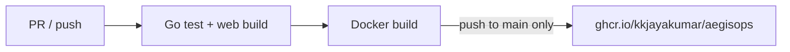

# CI/CD — Docker image on GHCR

AegisOps CI builds, tests, and publishes a Docker image to **GitHub Container Registry (GHCR)** on every push to `main`.

## Pipeline (`.github/workflows/ci.yml`)



| Trigger | Tests | Docker build | Push to GHCR |
|---------|-------|--------------|--------------|
| Pull request | Yes | Yes (validate only) | No |
| Push to `main` | Yes | Yes | Yes |

### Image tags

| Tag | When |
|-----|------|
| `latest` | Every successful `main` push |
| `sha-<7-char>` | Same commit (pin a deploy) |

Example: `ghcr.io/kkjayakumar/aegisops:latest`  
Package page: https://github.com/kkjayakumar/AegIsOps/pkgs/container/aegisops

---

## Local dev: build vs pull?

Use **both** — for different purposes:

| Mode | When to use | Command |
|------|-------------|---------|
| **Build from source** | Active development, uncommitted changes | `docker compose up -d --build` |
| **Pull published image** | Test exactly what CI shipped; restart after merge | `.\scripts\update-from-ghcr.ps1` |
| **Publish only** | CI on GitHub — you don't run this locally | Automatic on push to `main` |

**Recommendation**

- While coding → **build locally** (`docker compose up -d --build`)
- After merging to `main` → **pull GHCR image** to verify the published artifact (`update-from-ghcr.ps1`)
- Staging / EC2 → **always pull** from GHCR (never build on server)

You do **not** need to publish from your machine. GitHub Actions publishes on merge.

---

## Pull and restart locally

After CI publishes (check Actions tab on `main`):

```powershell
cd c:\Users\kkjay\Documents\personal\AegisOps

# Public package — no login
.\scripts\update-from-ghcr.ps1

# Private package — login once
$env:GITHUB_USER = "kkjayakumar"
$env:GITHUB_TOKEN = "<PAT with read:packages>"
.\scripts\update-from-ghcr.ps1 -Login

# Pin a specific commit
.\scripts\update-from-ghcr.ps1 -Tag sha-bd62c18
```

Manual equivalent:

```powershell
$env:AEGISOPS_IMAGE_TAG = "latest"
docker compose -f docker-compose.yml -f docker-compose.ghcr.yml pull aegisops
docker compose -f docker-compose.yml -f docker-compose.ghcr.yml up -d --no-build aegisops
```

Postgres still runs from `docker-compose.yml` (local volume unchanged). Only the **aegisops** app container is replaced.

---

## Make GHCR package public (optional)

If pull fails with 401/403 without login:

1. GitHub → **Packages** → `aegisops`
2. **Package settings** → Change visibility → **Public**

Or keep private and use a PAT with `read:packages`.

---

## Staging / production (EC2 auto-deploy)

On push to `main`, after **CI** succeeds:

1. **CI** builds and pushes `ghcr.io/kkjayakumar/aegisops:sha-<7>` and `:latest`
2. **deploy** workflow runs SSM on EC2 `i-0350a48d3222dd239`
3. EC2 script `deploy/ec2/deploy.sh` loads `.env` from Secrets Manager `dev/syntropix` and pulls the GHCR image

Compose stack on EC2:

```bash
cd /opt/aegisops/deploy/staging
docker compose \
  -f docker-compose.yml \
  -f docker-compose.external-db.yml \
  -f docker-compose.ghcr.yml \
  up -d --no-build aegisops
```

### GitHub repository secrets

| Secret | Purpose |
|--------|---------|
| `AWS_ACCESS_KEY_ID` | IAM user for SSM SendCommand |
| `AWS_SECRET_ACCESS_KEY` | Matching secret key |

Region: `ap-south-1` (set in workflow env).

### IAM — GitHub Actions user

```json
{
  "Version": "2012-10-17",
  "Statement": [
    {
      "Effect": "Allow",
      "Action": ["ssm:SendCommand", "ssm:GetCommandInvocation"],
      "Resource": [
        "arn:aws:ec2:ap-south-1:050530838083:instance/i-0350a48d3222dd239",
        "arn:aws:ssm:ap-south-1::document/AWS-RunShellScript"
      ]
    }
  ]
}
```

### IAM — EC2 role `syntropix-ec2-access`

Add (if missing):

```json
{
  "Effect": "Allow",
  "Action": "secretsmanager:GetSecretValue",
  "Resource": "arn:aws:secretsmanager:ap-south-1:050530838083:secret:dev/syntropix-*"
}
```

### Secrets Manager JSON

Store env vars as plain JSON in `dev/syntropix` (see `deploy/staging/.env.example`). Optional for private GHCR:

```json
"GHCR_USER": "kkjayakumar",
"GHCR_TOKEN": "<PAT with read:packages>"
```

### Manual deploy on EC2

```bash
chmod +x /opt/aegisops/deploy/ec2/deploy.sh
bash /opt/aegisops/deploy/ec2/deploy.sh sha-bd62c18
```

### Manual deploy from GitHub

Actions → **deploy** → **Run workflow** → optional `image_tag` (default: latest on main).

Set `AEGISOPS_IMAGE_TAG=sha-<commit>` to roll back.

---

## AegisOps webhook integration

Successful **deploy** workflow runs can trigger Sentinel via GitHub webhook (`workflow_run` event). After pulling a new image locally, CI on `main` will still fire webhooks when the GitHub Actions **docker** job completes — not when you pull locally.

For local restarts, use `update-from-ghcr.ps1` only; no webhook is sent unless you push to GitHub.
