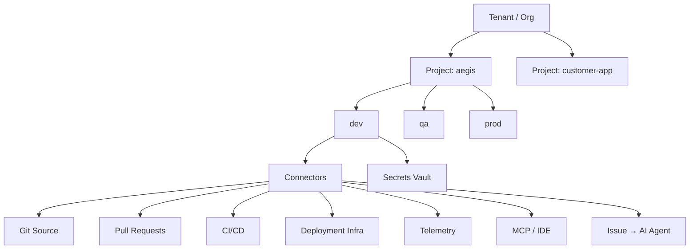

# AegisOps SaaS Architecture

Multi-tenant plan: **Tenant → Project → Environment → Connectors + Secrets**.

## Hierarchy



| Level | Example | Purpose |
|-------|---------|---------|
| **Tenant** | `syntropix` | Billing, SSO, org members |
| **Project** | `aegis` | Product/repo boundary |
| **Environment** | `dev`, `qa`, `prod` | Isolated config + secrets |
| **Connector** | GitHub, EC2 SSM, Copilot | Integration instance |
| **Secret** | `OPENAI_API_KEY` | Encrypted key/value per env |

## Connector types

| Type | ID | Purpose |
|------|-----|---------|
| Git source | `git` | Repo, default branch, GitHub App |
| Pull requests | `pull_request` | Auto-PR, branch pattern `aegis/fix-{id}` |
| CI/CD | `cicd` | GitHub Actions, workflow filters |
| Deployment | `deployment` | EC2/SSM, K8s, GHCR pull |
| Telemetry | `telemetry` | Copilot/Sentry, Spotting |
| MCP | `mcp` | Cursor MCP server, tool routing |
| Issue routing | `issue_agent` | Send fix issues to IDE / AI agent |

## Supported secret providers (API keys)

| Provider | Secret keys |
|----------|-------------|
| **OpenAI** | `OPENAI_API_KEY`, `OPENAI_ORG_ID` |
| **Anthropic (Claude)** | `ANTHROPIC_API_KEY` |
| **Google** | `GOOGLE_API_KEY`, `GOOGLE_CLOUD_PROJECT` |
| **Cursor** | `CURSOR_API_KEY` |
| **GitHub** | `GITHUB_TOKEN`, `GITHUB_APP_ID`, `GITHUB_APP_PRIVATE_KEY` |
| **AWS** | `AWS_ACCESS_KEY_ID`, `AWS_SECRET_ACCESS_KEY`, `AWS_REGION` |
| **Webhooks** | `AEGIS_WEBHOOK_SECRET`, `GITHUB_WEBHOOK_SECRET` |
| **Custom** | Any `KEY_NAME` per project/env |

Secrets are **never** returned in full after save — only masked (`sk-…x7Kp`).

## Data model (Phase 1 — implemented)

- `aegis_tenants` — org slug, name
- `aegis_projects` — tenant FK, slug (`aegis`), display name
- `aegis_environments` — project FK, slug (`dev`|`qa`|`prod`)
- `aegis_connectors` — env FK, type, name, config JSON, enabled
- `aegis_secrets` — env FK, provider, key_name, ciphertext

Future (Phase 2): `tenant_id` on `aegis_issues`, `aegis_deployments`; auth + RBAC; per-tenant encryption keys (KMS).

## API (Phase 1)

| Method | Path |
|--------|------|
| GET | `/api/v1/workspace/bootstrap` |
| GET/POST | `/api/v1/workspace/projects` |
| GET/POST | `/api/v1/workspace/projects/{id}/environments` |
| GET | `/api/v1/workspace/connectors/defaults` |
| GET/POST | `/api/v1/workspace/environments/{id}/connectors` |
| POST | `/api/v1/workspace/environments/{id}/connectors/apply-defaults` |
| GET/POST/DELETE | `/api/v1/workspace/environments/{id}/secrets` |

Headers (future auth): `X-Tenant-Slug`, `X-Project-Slug`, `X-Environment-Slug`.

## UI (Phase 1)

Route: **`/workspace`** — project/env switcher, tabs:

1. **Overview** — hierarchy + quick status
2. **Environments** — dev / qa / prod
3. **Connectors** — enable/configure integrations
4. **Secrets** — add API keys per provider

## Issue → IDE / AI agent flow (target)

```text
detect → correlate → approve → start_fix_from_issue
  → MCP (Cursor) OR issue_agent connector (OpenAI/Claude/Cursor API)
  → push aegis/fix-{id} → auto PR → merge → fixed
```

Connector `issue_agent` config:

```json
{
  "provider": "cursor|openai|anthropic",
  "route": "mcp|api",
  "model": "claude-sonnet-4-20250514"
}
```

## LLM API (not IDE-only)

Default route is **API keys** stored per environment:

| Provider | Secret |
|----------|--------|
| OpenAI | `OPENAI_API_KEY` |
| Anthropic | `ANTHROPIC_API_KEY` |
| Google | `GOOGLE_API_KEY` |
| Cursor | `CURSOR_API_KEY` |

MCP / IDE remains an optional fallback connector.

| Method | Path |
|--------|------|
| GET | `/api/v1/workspace/environments/{id}/llm/status` |
| POST | `/api/v1/workspace/environments/{id}/llm/complete` |
| GET | `/api/v1/workspace/environments/{id}/llm/runs` |

## Context graph (token savings + isolation)

Compact nodes/edges (`aegis_graph_*`) are retrieved per prompt instead of sending the full repository.

**Strict isolation (finance / healthcare compliance):** each graph is keyed only by `environment_id`. An environment belongs to exactly one project, and a project to exactly one tenant. Reads, writes, ingest, and LLM `useGraph` retrieval **never** merge nodes/edges across environments, projects, or tenants. When `projectId` is sent with LLM Complete (or `?projectId=` / `X-Project-Id` on graph routes), the server returns **403** if the path environment is not under that project. There is no shared global graph table; seed/ingest writes only into the target environment. Global issues are not auto-ingested into graphs until issues gain `project_id` / `environment_id`.

| Method | Path |
|--------|------|
| GET | `/api/v1/workspace/environments/{id}/graph` |
| POST | `/api/v1/workspace/environments/{id}/graph/ingest` |
| POST | `/api/v1/workspace/environments/{id}/graph/nodes` |

UI tabs: **LLM API** + **Context graph** under `/workspace`. Home chat labels context as scoped to the selected project/env.

## Migration path from single-tenant

1. Run migration `004_workspace.sql` (seeds default tenant + `aegis` + dev/qa/prod)
2. Map current `.env` / Secrets Manager JSON → workspace secrets via UI
3. Phase 2: scope issues/deployments by `project_id` + `environment_id`
4. Phase 3: tenant auth, billing, row-level security

## Encryption

Set `WORKSPACE_SECRETS_KEY` (32+ byte hex) on the server. Secrets encrypted with AES-256-GCM before Postgres storage.
