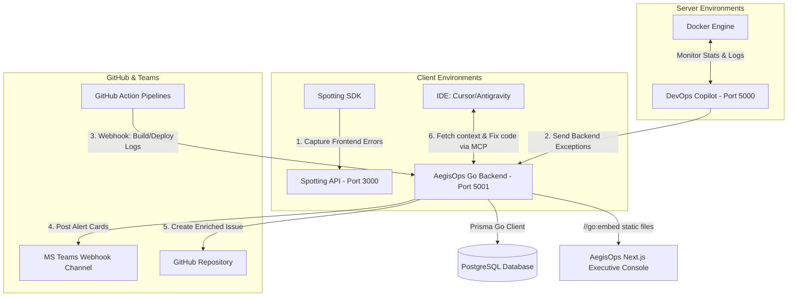

# AegisOps Orchestrator Architecture Specification (Go + Postgres + Next.js)

This document defines the architectural blueprint and technical stack for the **AegisOps Orchestrator**, built as a high-performance Go service, PostgreSQL database, and an embedded Next.js executive control panel.

---

## 🛠️ Technology Stack Specification

| Component | Technology | Rationale |
|---|---|---|
| **Core Backend** | Go (v1.22+) | Single-binary deploy, high concurrency, low memory usage. |
| **API Framework** | Standard Library `net/http` | Highly optimized standard router with pattern matching, serving JSON webhooks. |
| **Database** | PostgreSQL | Robust relational store. Separates the orchestrator's state from DevOps Copilot. |
| **ORM / Migrations** | Prisma Client Go | Type-safe client generator for Go keeping schema definitions synchronized. |
| **Executive Console** | **Next.js (React + TypeScript)** | Premium, glassmorphic layout using **Tailwind CSS v4** for clean dark-mode utility classes, animated gauges, and Svg status loops. |
| **Console Distribution** | Go `//go:embed` | Compiles Next.js statically (`output: "export"`) and bundles the static `/out` directory into the Go binary. |
| **IDE Bridge** | Model Context Protocol (MCP) | Go MCP SDK (`github.com/mark3labs/mcp-go`) over SSE transport. |

---

## 🏗️ System Architecture & Data Flow

The orchestrator operates at **Port 5001** and exposes both REST APIs and a unified web interface:

---

## 💻 Next.js Executive Console Features
Exposed directly at `http://localhost:5001/` (served from embedded assets), this dashboard provides:
1.  **Executive Health Board:** Frosted glass charts showing Uptime SLAs, system latency (APM), and AI code fix rates.
2.  **Correlated Telemetry Inspector:** Displays the frontend Spotting session replay side-by-side with backend Sentry exception traces and related Docker logs.
3.  **CI/CD Pipeline Monitor:** A log viewer displaying failed GitHub Action build outputs with syntax highlighting of compile errors.
4.  **Admin controls:** Interactive buttons to approve AI fixes or merge PRs.

---

## 🔄 Step-by-Step Orchestration Cycle
1.  **Ingestion:** Spotting and DevOps Copilot push errors. GitHub sends pipeline failures.
2.  **Correlation:** AegisOps matches errors via Request IDs, creating a token-optimized `.md` telemetry bundle.
3.  **Visualization & Notification:** AegisOps notifies Microsoft Teams and lists the incident in the **Web Console**.
4.  **Human Approval:** Developer reviews the telemetry inside the Web Console (or via Teams) and clicks **"Approve AI Fix"**.
5.  **Autonomous Fix:** Cursor IDE connects via MCP, reads the approved issue context, generates the code fix, and opens a GitHub PR.
6.  **Resolution:** The PR status updates on the Web Console, awaiting final merge approval.
